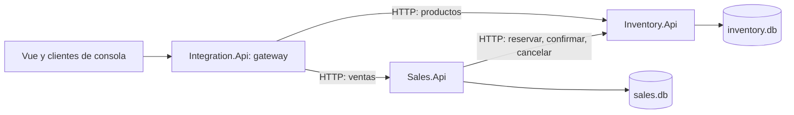

# Diseño de microservicios

## Responsabilidades



El gateway sirve también Vue desde `/`. Mantiene los contratos de artículos, clientes, vendedores y ventas bajo `/api/v1` y presenta Swagger. Dispone de `users.db` únicamente para la cuenta inicial; la lógica y las bases de negocio pertenecen a los microservicios. Los servicios se comunican por HTTP/JSON con `HttpClient` y no comparten tablas.

`Integration.Contracts` comparte DTO y convenciones HTTP, sin estado ni almacenamiento. `Shared/SqliteDb.cs` es código de conexión compilado en cada servicio, no una instancia compartida. Los proyectos pueden publicarse y ejecutarse por separado. El arranque conjunto del gateway es opcional y se desactiva con `START_LOCAL_SERVICES=false`.

## Datos

| Propietario | Tabla | Contenido |
|---|---|---|
| Inventario | `Artículos` | ID, descripción, precio en centavos, estado y stock disponible |
| Inventario | `reservations` | ID de operación, producto, cantidad, precio capturado y estado |
| Ventas | `sales` | ID, producto, cantidad, referencia única, total, estado, ID de operación y motivo de rechazo |
| Ventas | `Clientes` | ID, nombre o razón social, RNC o cédula, cuenta contable y estado |
| Ventas | `Vendedores` | ID, nombre, comisión en centésimas porcentuales y estado |
| Gateway | `Users` | Cuentas de acceso y hashes de contraseñas |

La tabla anterior `products` se renombra sin perder registros ni referencias; se conserva una vista de lectura para herramientas anteriores. Los artículos existentes reciben estado activo. No se permite reservar un artículo inactivo.

Una reserva descuenta el stock disponible inmediatamente. Confirmarla no lo vuelve a descontar. Cancelarla devuelve las unidades una sola vez. El precio unitario se captura al reservar; cambiar el catálogo después no altera el total histórico.

Inventario impide reemplazar el stock mientras existan reservas activas y conserva el historial mediante claves foráneas locales. Ventas almacena `productId` como identificador externo y no crea una clave foránea hacia la base de Inventario.

## Protocolo de venta y recuperación

1. Ventas registra `Pending` con referencia única e ID de operación estable antes de contactar a Inventario.
2. Solicita `POST /internal/reservations`. Inventario verifica stock, descuenta unidades y registra la reserva en una sola transacción de su base.
3. Ventas guarda el precio total y el estado `Confirming` en su base. Esta es la decisión persistente de confirmar.
4. Envía `POST /internal/reservations/{operationId}/confirm` y, al recibir respuesta, guarda `Confirmed`.

Si se pierde la respuesta al reservar, repetir el mismo ID devuelve la misma reserva sin otro descuento. Si se pierde la respuesta al confirmar, la confirmación repetida también devuelve el mismo resultado. Un proceso que reinicie encuentra los estados pendientes en su base.

Un trabajador de Ventas revisa `Pending`, `Confirming` y `Cancelling` cada tres segundos. No se crea una transacción distribuida: cada paso confirma únicamente la base de su servicio. Mientras falte una respuesta remota, la operación queda visible y devuelve 202. La recuperación requiere que el servicio y su almacenamiento vuelvan a estar disponibles.

Un rechazo al reservar (producto inexistente, stock insuficiente o conflicto) se guarda como `Rejected`, con motivo y estado HTTP. Esa referencia sigue identificando el intento; una nueva operación utiliza otra referencia. Reenviar una venta Confirmada con los mismos datos devuelve 200 y la venta original. Cambiar los datos de una referencia existente devuelve 409.

### Cancelación

`POST /api/v1/sales/{id}/cancel` cambia una venta Pending a Cancelling antes de pedir la liberación. El trabajador reintenta si Inventario está caído. Al completar la liberación se registra Cancelled. Una venta Confirming o Confirmed no se puede cancelar, porque la decisión de confirmar ya se hizo persistente.

Una cancelación que llegue antes que la reserva deja una marca en Inventario. Una solicitud de reserva tardía con ese ID se rechaza. Confirmar y cancelar se serializan mediante transacciones locales; una reserva confirmada nunca se libera por una cancelación posterior.

Las reservas no caducan automáticamente: expirar una reserva mientras Ventas está confirmando requeriría otro protocolo. En esta práctica se recuperan mediante el trabajador o una cancelación explícita. Si el almacenamiento se pierde de forma permanente, se necesita restauración y conciliación operativa; los reintentos no sustituyen las copias de seguridad.

## Endpoints públicos del gateway

Las rutas de negocio requieren una sesión autenticada o la cabecera `X-API-Key` si se configuró una clave de integración explícita.

| Método | Ruta | Respuesta correcta |
|---|---|---|
| GET | `/api/v1/products?offset=0&limit=100` | 200, productos |
| POST | `/api/v1/products` | 201, producto y Location |
| GET | `/api/v1/products/{id}` | 200, producto |
| PUT | `/api/v1/products/{id}` | 200, producto reemplazado |
| DELETE | `/api/v1/products/{id}` | 204, si no tiene historial |
| GET | `/api/v1/sales?offset=0&limit=100` | 200, ventas con estado |
| GET | `/api/v1/sales/{id}` | 200, estado de una venta |
| POST | `/api/v1/sales` | 201 confirmada, 200 reenvío confirmado, 202 pendiente |
| POST | `/api/v1/sales/{id}/cancel` | 200 cancelada, 202 cancelación pendiente |
| GET | `/health` | 200 si responden ambos servicios; 503 si falta alguno |

`/api/v1/articles`, `/api/v1/clients` y `/api/v1/sellers` ofrecen GET de lista y por ID, POST, PUT y DELETE. Las listas aceptan `offset` y `limit`. Los artículos usan el mismo inventario y las mismas reservas que `/api/v1/products`.

El acceso se gestiona con `GET /api/auth/status`, `POST /api/auth/setup`, `POST /api/auth/login`, `GET /api/auth/me` y `POST /api/auth/logout`. El usuario inicial puede crear cuentas mediante `POST /api/auth/users`; las cuentas creadas no pueden crear otras. La configuración inicial está restringida al loopback en Desarrollo o mediante habilitación expresa; en otros entornos se puede crear el primer usuario con variables de entorno. Las sesiones usan cookies HttpOnly y SameSite Strict, con protección de origen o cabecera en las operaciones de escritura. El inicio de sesión y la configuración inicial tienen límite de intentos por dirección.

Las listas tienen límite de 1–100 y offset desde cero. JSON usa camelCase y las cantidades monetarias son enteros en centavos de DOP. El cuerpo de creación de producto es `{"name":"Teclado","priceCents":150000,"stock":10}` y el de venta `{"productId":1,"quantity":3,"reference":"V-001"}`.

Una venta confirmada devuelve, por ejemplo:

```json
{"id":1,"productId":1,"quantity":3,"reference":"V-001","totalCents":450000,"status":"Confirmed","failure":null}
```

Los estados posibles son `Pending`, `Confirming`, `Confirmed`, `Rejected`, `Cancelling` y `Cancelled`. `totalCents` puede ser null antes de reservar. El cliente debe inspeccionar el estado, no interpretar cualquier respuesta 2xx como una confirmación.

Errores: 400 formato incorrecto, 401 clave ausente/incorrecta, 404 recurso inexistente, 409 conflicto, 422 validación y 503 servicio no disponible o base ocupada. El formato común es `{"error":{"code":"conflict","message":"Existencias insuficientes"}}`.

## Autenticación y disponibilidad

Vue inicia sesión con usuario y contraseña; no contiene una clave de acceso. Las aplicaciones de consola pueden usar `API_KEY` si fue configurada de forma explícita. El gateway y los servicios usan una clave distinta, `SERVICE_API_KEY`, para las llamadas internas. El gateway no publica las rutas `/internal`. Inventario exige la clave interna tanto para sus rutas de productos como para las reservas.

Un fallo de Ventas no impide consultar productos directamente a través del gateway. El estado global `/health` informa de la degradación; no reemplaza la validación individual de cada solicitud. El usuario inicial puede crear cuentas; esta entrega no incluye administración de roles ni desactivación o recuperación de cuentas.

## Operación y límites de la práctica

SQLite proporciona persistencia y transacciones locales. Ventas serializa la coordinación por proceso para simplificar el ejemplo; las restricciones únicas, los cambios condicionales de estado y las reservas idempotentes son las garantías persistentes. Para una carga mayor habría que revisar la capacidad de escritura, particionar el trabajo de recuperación y elegir almacenamiento apropiado.

En desarrollo, el gateway inicia dos procesos y los detiene al cerrarse normalmente. La publicación incluye sus DLL bajo `services/`; puede desplegarse como paquete o iniciar cada servicio por separado. El arranque local no sustituye un gestor de procesos para supervisión y reinicios en un despliegue independiente.

## Pruebas

Las pruebas usan servidores Kestrel reales en puertos temporales, clientes HTTP y una base por servicio. Comprueban que las tablas de Inventario no existen en Ventas ni al revés; simulan la pérdida de respuestas después de aplicar una reserva o confirmación; reinician servicios conservando sus archivos y verifican que el stock solo se descuenta una vez. También cubren cancelación, concurrencia, disponibilidad parcial, contratos y migración de la base anterior.

`scripts/Test-PublishedApp.ps1` verifica, con procesos separados y bases aisladas, el paquete publicado. `-Development` prueba el arranque conjunto con `dotnet run --no-build` después de compilar.
